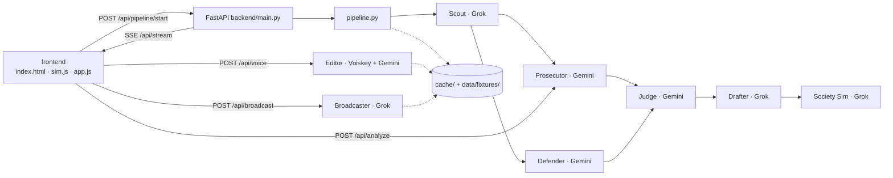

# CounterFire · Firebreak

A misinformation response desk for county emergency comms teams. It catches a viral wildfire rumor, has AI agents argue over the photo, drafts corrections, tests them on simulated residents, and lets the comms officer approve by voice. The spread map shows the correction racing the rumor.

Built for **Five Nights with AI** (ACM AI x TESC, UC San Diego). Full build plan: [FIREBREAK_PLAN.md](FIREBREAK_PLAN.md).

| Agent | Sponsor | Status | What it does |
|---|---|---|---|
| Scout | Grok | stub (fixture) | Groups posts into one incident, extracts the claim |
| Prosecutor | Gemini | **built** | Image forensics with boxes (`box_2d`) + Google Search check for earlier copies |
| Defender | Gemini | **built** | Strongest honest case that the post is real |
| Judge | Gemini | **built** | Verdict, calibrated confidence, missing evidence (strict JSON) |
| Drafter | Grok | stub (fixture) | 3 corrections, English + Spanish |
| Society Sim | Grok | stub (fixture) | 6 persona groups score each correction; scores drive the map |
| Editor | Voiskey + Gemini | Gemini fallback built | Voice note → clean posts + commands |
| Broadcaster | Grok | stub (fixture) | Posts to the in-app feed, answers replies |

## Run it

```bash
py -3.14 -m venv .venv
.venv/Scripts/python -m pip install -r requirements.txt
cp .env.example .env        # then add GEMINI_API_KEY
.venv/Scripts/python scripts/smoke_test.py
.venv/Scripts/python -m uvicorn backend.main:app --reload --port 8000
```

Open http://localhost:8000 and press **Start scenario**. With no keys, every agent falls back to `data/fixtures/` and its pipeline pill says "fixture". The demo still runs end to end.

## Demo modes (`DEMO_MODE` in `.env`)

- `hybrid` (default): the pipeline reads from `cache/` when it can. Voice, Analyze, Broadcast and Draft ask run live.
- `live`: every call is real.
- `replay`: everything from cache. Use this if the wifi dies.

A live call that fails or times out falls back to cache, then to the fixture. Before the demo, run `scripts/warm_cache.py` 2 or 3 times and keep the best run.

## Scripts

| Script | What it does |
|---|---|
| `scripts/smoke_test.py` | Lists the Gemini models your key can use; tests text, image + boxes, search grounding, audio |
| `scripts/warm_cache.py` | Runs the pipeline live once and saves every result to `cache/` |
| `scripts/run_eval.py` | Prosecutor → Defender → Judge on 30 PolitiFact claims (LIAR). Writes `cache/eval.json`; the Judge pill shows "eval X/30" |
| `scripts/rasterize_svg.py` | Rebuilds `data/viral.png` from the UI's SVG (needs `npm install --prefix scripts/.node @resvg/resvg-js@2.6.2`) |

## For the Grok and Voiskey side

Fill in the function bodies and keep the signatures. Everything else (pipeline, cache, SSE, UI) is already wired.

- `backend/clients/grok_client.py`: `grok_json(system, user, schema)` is written. Set `XAI_API_KEY` and `GROK_MODEL`.
- `backend/agents/scout.py`: `run(posts, incident_id) -> Incident`
- `backend/agents/drafter.py`: `run(incident, judge) -> DrafterOut`
- `backend/agents/society.py`: `run(framings, claim) -> SocietyAll` (6 scores per framing, GROUPS order)
- `backend/agents/broadcaster.py`: `run(framing_key, post_en, post_es, replies) -> BroadcastOut`
- `backend/clients/voiskey_client.py`: `transcribe_and_clean(audio, mime) -> (raw, clean)`. The mic sends 16 kHz mono WAV. If Voiskey is a desktop dictation app with no API, `POST /api/voice` also takes a `text` field.

The shapes are in `backend/schemas.py`. The fixtures in `data/fixtures/` are working examples of each output.

## Architecture



The backend sends each result as soon as it's ready, tagged with the sim minute it belongs at (Scout T+2, Prosecutor and Defender T+12, Judge T+15, Drafter T+18, Society T+22, Editor T+23). The frontend holds each result until the map clock reaches that minute, and pauses the clock if a result is late.
