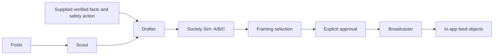

# Firebreak / CounterFire

Grok agents for a misinformation response desk: detect a shared claim, draft bilingual responses, compare fictional audience reactions, and prepare approved corrections for an in-app feed.

Implemented: **Scout, Drafter, Society Sim, and Broadcaster**. The original HTML and simulation are unchanged. Frontend wiring, FastAPI, Gemini verification, and Voiskey editing are separate work.

## Official Grokbots webhook transport

The project also has an official-routine HTTP sender in `backend/clients/grokbots_webhook.py`. This is independent of the xAI API and the optional community `gbot` CLI. It triggers an existing native Bot routine using the URL and bearer key shown by Grokbots. See [the official routine documentation](https://cursor.com/help/grok-bot/routines).

Trial has a webhook-only routine named **Firebreak webhook connectivity**. It echoes a request ID and synthetic observation in Trial's chat. To open its settings, use the routine link in chat. If the normal card only opens the routine list, ask Trial for the direct in-app **Webhook URL** settings link.

Put the displayed URL and key in the ignored `.env` file as `GROKBOTS_WEBHOOK_URL` and `GROKBOTS_WEBHOOK_KEY`, then run:

```sh
python3 scripts/test_grokbots_webhook.py
```

The sender makes one request and prints a receipt with a correlation ID. HTTP 200 means the run started, not that the Bot finished. Verify the matching ID and echoed observation in Trial's chat. Unknown delivery is not retried automatically. Keys, response bodies, and URLs are excluded from receipts; redirects are refused.

The routine now supports a structured action callback as well as the original connectivity echo. The callback path is described below. The six-community simulation and dashboard consumption of these actions remain separate work.

Live connectivity verified on October 24, 2026: the sender received HTTP 200, and Trial echoed request ID `firebreak-official-smoke-20261024-01` with the exact synthetic observation in its native chat. This test used the official routine webhook, with no xAI API key or community CLI. Credentials are stored only in the ignored local `.env`.

## Authenticated Bot action return

Start the dedicated callback receiver on the Mac:

```sh
python3 -m uvicorn backend.grokbots_return:app_factory --factory --host 127.0.0.1 --port 8766 --no-access-log
```

Expose **only this receiver** with an authenticated application protocol over a temporary tunnel, for example Cloudflare's official `cloudflared`:

```sh
cloudflared tunnel --url http://127.0.0.1:8766 --no-autoupdate --protocol http2
```

Ask Trial to update the existing routine's allowed callback hostname to the exact new tunnel hostname before dispatching. Its current instructions pin the hostname used for the verified test. A fresh Quick Tunnel gets a different hostname. The routine must reject other hosts, redirects, credential-bearing URLs, query strings, and mismatched request paths.

The routine consumes `observation.task`, `observation_hash`, `callback`, and `result_schema`. It chooses a fictional social action from `share`, `question`, `verify`, `reply`, `retract`, or `wait`, then posts the structured result to `callback.url` with the scoped bearer token. It must not echo the token or full callback packet in chat. See the implementation plan for the intended limits; this callback does not authorize publishing.

With the receiver and tunnel running, trigger one task:

```sh
python3 scripts/test_grokbots_roundtrip.py --callback-base-url https://YOUR-TUNNEL.trycloudflare.com
```

The script creates a durable task, sends it once through the official Bot webhook, and watches its local completion. The callback requires the matching episode, round, group, request ID, observation hash, and expiring random capability. Only the capability hash is stored. Identical callbacks are idempotent; conflicting or superseded results fail. The public receiver exposes no static files, job-listing, approval, or documentation endpoints. Results live in ignored `cache/grokbots/jobs.sqlite3`; the database file has owner-only permissions.

Live round trip verified October 24, 2026: request `acbf17f9-693a-4153-8d9c-d83c31987b94` was accepted by the official trigger, and Trial returned `action=verify`, `belief=0.30` to Python. The task completed through the authenticated callback, not by reading chat. This is synthetic scenario behavior, not an assessment of a real emergency. The temporary receiver and tunnel were stopped after the test.

## Run without an API key

Requires Python 3.11 or newer. From the project directory:

```sh
python3 -m venv .venv
source .venv/bin/activate
python3 -m pip install -r requirements.txt
python3 scripts/run_grok.py --fixtures --approve
```

This prints JSON for all four agents, the three sets of audience scores, the recommended framing, simulation parameters, and feed items. Without `--approve`, it stops before Broadcaster and reports `waiting_for_approval`.

**Fixtures are hand-authored synthetic outputs, not Grok responses.** The scenario, social accounts, verification facts, and 20 personas are fictional. They establish no current emergency conditions. Audience scores illustrate an experiment, not measured public behavior.

Warm the offline cache and replay without a network:

```sh
python3 scripts/warm_cache.py --fixtures --approve
python3 scripts/run_grok.py --fixtures --mode replay --approve
```

## Connect Grok later

Copy `.env.example` to `.env` and set `XAI_API_KEY`. Discover models available to that key:

```sh
python3 scripts/smoke_test.py --list-models
```

Set `GROK_MODEL` to an exact returned ID. Optionally set `GROK_FAST_MODEL` for Society Sim. Verify connectivity, then warm real responses:

```sh
python3 scripts/smoke_test.py
python3 scripts/warm_cache.py --approve
python3 scripts/run_grok.py --mode replay --approve
```

Live runs make real Grok calls on the **same fictional exercise**. They do not fetch live X posts or verify the incident. The standard xAI adapter can be replaced behind the provider interface if the track supplies a different SDK.

Live access remains unverified until a key and model IDs are supplied. The API boundary is tested with the real OpenAI SDK and an offline HTTP transport, following [xAI structured output documentation](https://docs.x.ai/developers/model-capabilities/text/structured-outputs).

## Agent interfaces

Every module in `backend/agents/` exports `run(inputs, runner)`. Inputs are Pydantic models from `backend/schemas.py`. Results contain `payload` and a `status` of `done` or `cached`.

- **Scout:** `ScoutInput` to `Incident`. The model selects related post IDs. Python computes counts and velocity from those posts only. Velocity is count divided by the first-to-last timestamp span in minutes, with a one-minute minimum. Timestamps require a timezone.
- **Drafter:** `DraftInput` to `DrafterOut.framings`. Requires verification facts, a verdict, a safety action, and an official source. Generates A/B/C with English and Spanish copy, each at most 280 characters. Prompts retain uncertainty and prohibit invented eyewitnesses or evacuation orders. Accuracy still needs human review.
- **Society Sim:** `SocietyInput` to `SocietyOut`. One request per framing covers six groups plus an English-only score for the Spanish-speaking group. `simulation_parameters()` supplies `p` and `es_off_mult` for later UI wiring. A zero Spanish score uses a neutral multiplier of 1. `recommend()` selects the highest mean belief drop, with A/B/C tie order.
- **Broadcaster:** `BroadcastInput` to `BroadcasterOut`. Requires explicit approval. Copies approved posts exactly and generates replies matched to question IDs. Returns only `@CountyComms_demo` feed objects. `reply_status` is `done`, `not_requested`, or `unavailable`. Optional reply failures do not suppress approved posts; unavailable replies are not cached as completed responses.

The demo substitutes supplied scenario verification for Gemini. Other callers must provide facts and safety actions from their trusted incident workflow. No agent has social publishing tools.



## Cache behavior

- `live`: attempts fresh generation with exact-input cache fallback on failure or timeout.
- `hybrid`: reuses pipeline cache when present. Broadcaster attempts fresh replies after approval, with cache fallback.
- `replay`: reads matching cache only. Missing or invalid entries raise `CacheMiss`; no API requests occur.

Keys cover inputs, prompts, prompt version, schema, provider identity, and model. Changed inputs cannot reuse an unrelated response. Fixture content is hashed into its provider identity. Fixture caches live in `cache/fixtures`, xAI caches in `cache/grok`. Both are ignored by Git. Keep the same model configuration when replaying a live cache. Broadcaster caches generated replies; feed posts are constructed directly from approved input.

The default generation deadline is eight seconds per agent. Configure `GROK_TIMEOUT_SECONDS` if needed. Timed-out workers cannot overwrite cache entries later. With no matching cache, pipeline failure is reported; Broadcaster can still return approved posts with replies marked unavailable.

## Tests

```sh
python3 -m unittest discover -v
```

Tests cover SDK request formatting, output validation and failure branches, timestamp velocity, approval, exact approved copy, reply IDs, score mapping, cache isolation and recovery, and full offline generation/replay through the CLI. No API key is needed.
