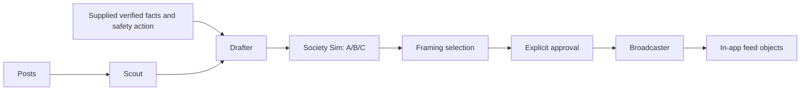

# Firebreak / CounterFire

A misinformation response desk for county emergency comms. **Gemini** verifies the viral photo, **Grok** Bots run the town and the comms desk, and **Voiskey** lets the officer edit by voice. Everything is a fictional exercise; nothing posts to real social media.

## Quick start (combined app)

```bash
python -m venv .venv
```
```bash
.venv/Scripts/python -m pip install -r requirements.txt
```
```bash
.venv/Scripts/python -m uvicorn backend.main:app_factory --factory --host 127.0.0.1 --port 8000
```

Copy `.env.example` to `.env` and fill in `GEMINI_API_KEY` (and the Grokbots values for live Grok mode). Open http://127.0.0.1:8000, pick **Fixture**, and press **Start episode**.

### The demo flow

The blue button in the header always shows the next step, so the whole demo is one button plus your voice.

1. **Start episode.** Gemini checks the viral photo on its own: a scan line runs over the image, then the boxes, findings, Prosecutor vs Defender, and the Judge's ruling appear. The result becomes the episode's evidence. **Check your own image** runs the same debate live on any image (shown only, it doesn't change the episode).
2. **Draft corrections.** Grok writes Fact check, Action first and Neighbor voice in English and Spanish.
3. **Run round 1** and **Run round 2.** Six Grok community Bots play 20 personas on the 240-account map. Each message delivery travels its edge on the map.
4. **Decision point.** Pick a correction, or click the Editor's note box, hold **Right Alt**, and talk to Voiskey: "Use action first. Send it to Poway, the parent groups and the influencers. Do Spanish too." Gemini rewrites the copy and sets the communities. Backup: hold the purple mic, or **Play the sample voice note**.
5. **Approve and send.** You approve the exact text on screen. Voice never approves on its own.
6. **Run round 3** and **Run round 4,** then **Answer replies.** **Details** (header) holds branches, saved runs, imports and the raw evidence packet.

### Gemini notes

- Code lives in `backend/gemini/` (agents, client, cache in `cache/gemini/`) and `frontend/gemini.js`. Endpoints: `POST /api/gemini/episodes/{id}/evidence`, `POST /api/analyze`, `POST /api/voice`, `POST /api/draft_ask`.
- Free tier: 5 requests/min and 20/day per model, no Google Search grounding, no image generation. `GEMINI_FALLBACK_MODEL` lists backups tried on 429/503. Warm the cache once per laptop (`scripts/gemini_warm_cache.py`, 3 calls) so episodes load the verification with no quota.
- Scripts: `gemini_smoke_test.py`, `gemini_warm_cache.py`, `run_eval.py` (30 LIAR claims, needs about 90 calls), `generate_image.py` (realistic photo, needs billing).

### Live Grok mode

Live mode uses your teammate's seven native Grokbots routines. It needs, in `.env`: the Comms routine URL/key, all six community URL/key pairs, and `GROKBOTS_CALLBACK_BASE_URL`. Run the callback service on port 8766 (`backend.grokbots_return:app_factory`), expose only that port with an HTTPS tunnel (`cloudflared tunnel --url http://127.0.0.1:8766`), and add the tunnel hostname to all seven routines' allowlists. The simplest path is to run live mode on the laptop where the routines are already configured, adding `GEMINI_API_KEY` to its `.env`. Details below.

---


Grok agents for a misinformation response desk: detect a shared claim, draft bilingual responses, compare fictional audience reactions, and prepare approved corrections for an in-app feed.

Implemented: the connected FastAPI desk, native Grokbots Scout/Drafter/Broadcaster, six autonomous community Bots, the social environment, exact-copy intervention approval, counterfactual branches, and durable recording/replay. Gemini verification and the Voiskey editor are wired in (see Quick start); the manual JSON import boxes remain as fallbacks. The original `firebreak-ui.html` remains available at `/baseline`.

## Run the connected app

Install `requirements.txt`, then run in two terminals:

```sh
python3 -m uvicorn backend.main:app_factory --factory --host 127.0.0.1 --port 8000 --no-access-log
python3 -m uvicorn backend.grokbots_return:app_factory --factory --host 127.0.0.1 --port 8766 --no-access-log
```

Open http://127.0.0.1:8000. Fixture mode needs no credentials. Start, advance two rounds, choose/edit a correction, propose the exact copy, approve it, and advance two further rounds. Save a completed trajectory to replay it. Replays require fresh approval of the recorded correction and display their source mode.

Live mode uses **official Grokbots routine webhooks**, without the community CLI or an xAI API key. Configure all six community URL/key pairs and Comms URL/key in `.env` using `.env.example`. Group IDs: 0 Poway, 1 Escondido, 2 Influencers, 3 Retirees, 4 Reporters, 5 Skeptics. Native routines are `Firebreak community round`; Trial's existing `Firebreak webhook connectivity` routine handles Scout, Drafter and Broadcaster.

Expose **only port 8766** through an HTTPS tunnel and set `GROKBOTS_CALLBACK_BASE_URL` to its origin. Keep the control/UI server on loopback. Each native routine must explicitly allow that exact tunnel hostname for `GET /api/tasks/{request_id}` and `POST /api/results/{request_id}`; when a temporary hostname changes, update `.env` and all seven routine allowlists. A temporary tunnel must remain running throughout live episodes. See [native routine setup](docs/grokbots-routines.md).

The compact trigger includes a scoped task URL and expiring bearer capability. The Bot fetches its full observation and response schema, then submits one result. This avoids native webhook context truncation. The receiver exposes no controls, files, docs or job list. No automatic POST retry or fixture fallback occurs. Pending requests, errors, mode and provenance remain visible.

## What the simulation does

Twenty fictional personas represent 240 accounts on the original 705-edge graph. Each native community Bot decides once per persona per round using only that persona's received messages, belief/history and local feedback. Python validates every decision and applies all six communities atomically. Shares travel through actual graph edges; verification queues supplied evidence for a later round; Spanish comprehension and source trust are observable inputs. Receiving a correction does not itself change belief. Neutral map nodes include unseen accounts and exposed accounts that have not adopted either claim; community detail panels report actual exposure separately.

Two rounds lead to the approval decision point. Approved copy is seeded into chosen communities, followed by two response rounds. Counterfactual branches fork the same pre-intervention state with independent memories. They compare computed simulated outcomes, not predictive population estimates. Feedback is logged for analysis; model weights are **not trained with reinforcement learning**.

The local API accepts evidence at `POST /api/episodes/{id}/evidence` with `verdict`, `verified_facts`, optional `incident_id`, findings, reasoning, source_refs and revision. No Gemini findings are fabricated in live mode. Normalized Voiskey input uses `{framing_key, text_en, text_es, target_groups}` through the editor, then the same proposal/hash approval path. Broadcaster replies use actual community questions or explicitly supplied question JSON and remain inside the app.

`cache/society/` stores episodes, branch histories and recordings; `cache/grokbots/jobs.sqlite3` stores task/result audit data. Both are ignored. Do not expose the UI server or share `.env`.

## Verification

The complete native exercise was verified on October 24, 2026: episode `038f8dc1-ba99-47a2-b33a-14abe3f9b0de` completed Scout, four six-community rounds, three bilingual drafts, exact-copy approval and two bilingual Broadcaster replies. Its evidence was an explicitly labeled fictional exercise bulletin, not a Gemini result. Recording `3d46185c-903f-4ac9-ae68-b43606535f7c` replayed with identical frames/feed and a fresh approval. These local audit IDs are not credentials.

The test suite has 80 passing tests, including native transport integration using authenticated task pulls and durable callbacks, partial-round rejection, approvals, branching, evidence isolation and replay. Native services were restarted after the test; episodes persist on disk.

## Legacy API/CLI adapters

The sections below also document the original optional xAI API adapter and its fixture demo. The connected desk above uses native routine webhooks.

## Official Grokbots webhook transport

The project also has an official-routine HTTP sender in `backend/clients/grokbots_webhook.py`. This is independent of the xAI API and the optional community `gbot` CLI. It triggers an existing native Bot routine using the URL and bearer key shown by Grokbots. See [the official routine documentation](https://cursor.com/help/grok-bot/routines).

Trial has a webhook-only routine named **Firebreak webhook connectivity**. It now routes typed Comms tasks and returns authenticated results; legacy connectivity echoes remain supported. To open its settings, use the routine link in chat. If the normal card only opens the routine list, ask Trial for the direct in-app **Webhook URL** settings link.

Put the displayed URL and key in the ignored `.env` file as `GROKBOTS_WEBHOOK_URL` and `GROKBOTS_WEBHOOK_KEY`, then run:

```sh
python3 scripts/test_grokbots_webhook.py
```

The sender makes one request and prints a receipt with a correlation ID. HTTP 200 means the run started, not that the Bot finished. Verify the matching ID and echoed observation in Trial's chat. Unknown delivery is not retried automatically. Keys, response bodies, and URLs are excluded from receipts; redirects are refused.

The routine now supports a structured action callback as well as the original connectivity echo. The callback path is described below. The six-community simulation and dashboard consumption of these actions remain separate work.

Live connectivity verified on October 24, 2026: the sender received HTTP 200, and Trial echoed request ID `firebreak-official-smoke-20261024-01` with the exact synthetic observation in its native chat. This test used the official routine webhook, with no xAI API key or community CLI. Credentials are stored only in the ignored local `.env`.

## Authenticated Bot action return

Start the dedicated callback receiver on the Mac:

```sh
python3 -m uvicorn backend.grokbots_return:app_factory --factory --host 127.0.0.1 --port 8766 --no-access-log
```

Expose **only this receiver** with an authenticated application protocol over a temporary tunnel, for example Cloudflare's official `cloudflared`:

```sh
cloudflared tunnel --url http://127.0.0.1:8766 --no-autoupdate --protocol http2
```

Ask Trial to update the existing routine's allowed callback hostname to the exact new tunnel hostname before dispatching. Its current instructions pin the hostname used for the verified test. A fresh Quick Tunnel gets a different hostname. The routine must reject other hosts, redirects, credential-bearing URLs, query strings, and mismatched request paths.

The routine consumes `observation.task`, `observation_hash`, `callback`, and `result_schema`. It chooses a fictional social action from `share`, `question`, `verify`, `reply`, `retract`, or `wait`, then posts the structured result to `callback.url` with the scoped bearer token. It must not echo the token or full callback packet in chat. See the implementation plan for the intended limits; this callback does not authorize publishing.

With the receiver and tunnel running, trigger one task:

```sh
python3 scripts/test_grokbots_roundtrip.py --callback-base-url https://YOUR-TUNNEL.trycloudflare.com
```

The script creates a durable task, sends it once through the official Bot webhook, and watches its local completion. The callback requires the matching episode, round, group, request ID, observation hash, and expiring random capability. Only the capability hash is stored. Identical callbacks are idempotent; conflicting or superseded results fail. The public receiver exposes no static files, job-listing, approval, or documentation endpoints. Results live in ignored `cache/grokbots/jobs.sqlite3`; the database file has owner-only permissions.

Live round trip verified October 24, 2026: request `acbf17f9-693a-4153-8d9c-d83c31987b94` was accepted by the official trigger, and Trial returned `action=verify`, `belief=0.30` to Python. The task completed through the authenticated callback, not by reading chat. This is synthetic scenario behavior, not an assessment of a real emergency. The temporary receiver and tunnel were stopped after the test.

## Run without an API key

Requires Python 3.11 or newer. From the project directory:

```sh
python3 -m venv .venv
source .venv/bin/activate
python3 -m pip install -r requirements.txt
python3 scripts/run_grok.py --fixtures --approve
```

This prints JSON for all four agents, the three sets of audience scores, the recommended framing, simulation parameters, and feed items. Without `--approve`, it stops before Broadcaster and reports `waiting_for_approval`.

**Fixtures are hand-authored synthetic outputs, not Grok responses.** The scenario, social accounts, verification facts, and 20 personas are fictional. They establish no current emergency conditions. Audience scores illustrate an experiment, not measured public behavior.

Warm the offline cache and replay without a network:

```sh
python3 scripts/warm_cache.py --fixtures --approve
python3 scripts/run_grok.py --fixtures --mode replay --approve
```

## Connect Grok later

Copy `.env.example` to `.env` and set `XAI_API_KEY`. Discover models available to that key:

```sh
python3 scripts/smoke_test.py --list-models
```

Set `GROK_MODEL` to an exact returned ID. Optionally set `GROK_FAST_MODEL` for Society Sim. Verify connectivity, then warm real responses:

```sh
python3 scripts/smoke_test.py
python3 scripts/warm_cache.py --approve
python3 scripts/run_grok.py --mode replay --approve
```

Live runs make real Grok calls on the **same fictional exercise**. They do not fetch live X posts or verify the incident. The standard xAI adapter can be replaced behind the provider interface if the track supplies a different SDK.

Live access remains unverified until a key and model IDs are supplied. The API boundary is tested with the real OpenAI SDK and an offline HTTP transport, following [xAI structured output documentation](https://docs.x.ai/developers/model-capabilities/text/structured-outputs).

## Agent interfaces

Every module in `backend/agents/` exports `run(inputs, runner)`. Inputs are Pydantic models from `backend/schemas.py`. Results contain `payload` and a `status` of `done` or `cached`.

- **Scout:** `ScoutInput` to `Incident`. The model selects related post IDs. Python computes counts and velocity from those posts only. Velocity is count divided by the first-to-last timestamp span in minutes, with a one-minute minimum. Timestamps require a timezone.
- **Drafter:** `DraftInput` to `DrafterOut.framings`. Requires verification facts, a verdict, a safety action, and an official source. Generates A/B/C with English and Spanish copy, each at most 280 characters. Prompts retain uncertainty and prohibit invented eyewitnesses or evacuation orders. Accuracy still needs human review.
- **Society Sim:** `SocietyInput` to `SocietyOut`. One request per framing covers six groups plus an English-only score for the Spanish-speaking group. `simulation_parameters()` supplies `p` and `es_off_mult` for later UI wiring. A zero Spanish score uses a neutral multiplier of 1. `recommend()` selects the highest mean belief drop, with A/B/C tie order.
- **Broadcaster:** `BroadcastInput` to `BroadcasterOut`. Requires explicit approval. Copies approved posts exactly and generates replies matched to question IDs. Returns only `@CountyComms_demo` feed objects. `reply_status` is `done`, `not_requested`, or `unavailable`. Optional reply failures do not suppress approved posts; unavailable replies are not cached as completed responses.

The demo substitutes supplied scenario verification for Gemini. Other callers must provide facts and safety actions from their trusted incident workflow. No agent has social publishing tools.



## Cache behavior

- `live`: attempts fresh generation with exact-input cache fallback on failure or timeout.
- `hybrid`: reuses pipeline cache when present. Broadcaster attempts fresh replies after approval, with cache fallback.
- `replay`: reads matching cache only. Missing or invalid entries raise `CacheMiss`; no API requests occur.

Keys cover inputs, prompts, prompt version, schema, provider identity, and model. Changed inputs cannot reuse an unrelated response. Fixture content is hashed into its provider identity. Fixture caches live in `cache/fixtures`, xAI caches in `cache/grok`. Both are ignored by Git. Keep the same model configuration when replaying a live cache. Broadcaster caches generated replies; feed posts are constructed directly from approved input.

The default generation deadline is eight seconds per agent. Configure `GROK_TIMEOUT_SECONDS` if needed. Timed-out workers cannot overwrite cache entries later. With no matching cache, pipeline failure is reported; Broadcaster can still return approved posts with replies marked unavailable.

## Tests

```sh
python3 -m unittest discover -v
```

Tests cover SDK request formatting, output validation and failure branches, timestamp velocity, approval, exact approved copy, reply IDs, score mapping, cache isolation and recovery, and full offline generation/replay through the CLI. No API key is needed.
