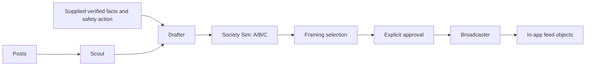

# Firebreak / CounterFire

Grok agents for a misinformation response desk: detect a shared claim, draft bilingual responses, compare fictional audience reactions, and prepare approved corrections for an in-app feed.

Implemented: **Scout, Drafter, Society Sim, and Broadcaster**. The original HTML and simulation are unchanged. Frontend wiring, FastAPI, Gemini verification, and Voiskey editing are separate work.

## Run without an API key

Requires Python 3.11 or newer. From the project directory:

```sh
python3 -m venv .venv
source .venv/bin/activate
python3 -m pip install -r requirements.txt
python3 scripts/run_grok.py --fixtures --approve
```

This prints JSON for all four agents, the three sets of audience scores, the recommended framing, simulation parameters, and feed items. Without `--approve`, it stops before Broadcaster and reports `waiting_for_approval`.

**Fixtures are hand-authored synthetic outputs, not Grok responses.** The scenario, social accounts, verification facts, and 20 personas are fictional. They establish no current emergency conditions. Audience scores illustrate an experiment, not measured public behavior.

Warm the offline cache and replay without a network:

```sh
python3 scripts/warm_cache.py --fixtures --approve
python3 scripts/run_grok.py --fixtures --mode replay --approve
```

## Connect Grok later

Copy `.env.example` to `.env` and set `XAI_API_KEY`. Discover models available to that key:

```sh
python3 scripts/smoke_test.py --list-models
```

Set `GROK_MODEL` to an exact returned ID. Optionally set `GROK_FAST_MODEL` for Society Sim. Verify connectivity, then warm real responses:

```sh
python3 scripts/smoke_test.py
python3 scripts/warm_cache.py --approve
python3 scripts/run_grok.py --mode replay --approve
```

Live runs make real Grok calls on the **same fictional exercise**. They do not fetch live X posts or verify the incident. The standard xAI adapter can be replaced behind the provider interface if the track supplies a different SDK.

Live access remains unverified until a key and model IDs are supplied. The API boundary is tested with the real OpenAI SDK and an offline HTTP transport, following [xAI structured output documentation](https://docs.x.ai/developers/model-capabilities/text/structured-outputs).

## Agent interfaces

Every module in `backend/agents/` exports `run(inputs, runner)`. Inputs are Pydantic models from `backend/schemas.py`. Results contain `payload` and a `status` of `done` or `cached`.

- **Scout:** `ScoutInput` to `Incident`. The model selects related post IDs. Python computes counts and velocity from those posts only. Velocity is count divided by the first-to-last timestamp span in minutes, with a one-minute minimum. Timestamps require a timezone.
- **Drafter:** `DraftInput` to `DrafterOut.framings`. Requires verification facts, a verdict, a safety action, and an official source. Generates A/B/C with English and Spanish copy, each at most 280 characters. Prompts retain uncertainty and prohibit invented eyewitnesses or evacuation orders. Accuracy still needs human review.
- **Society Sim:** `SocietyInput` to `SocietyOut`. One request per framing covers six groups plus an English-only score for the Spanish-speaking group. `simulation_parameters()` supplies `p` and `es_off_mult` for later UI wiring. A zero Spanish score uses a neutral multiplier of 1. `recommend()` selects the highest mean belief drop, with A/B/C tie order.
- **Broadcaster:** `BroadcastInput` to `BroadcasterOut`. Requires explicit approval. Copies approved posts exactly and generates replies matched to question IDs. Returns only `@CountyComms_demo` feed objects. `reply_status` is `done`, `not_requested`, or `unavailable`. Optional reply failures do not suppress approved posts; unavailable replies are not cached as completed responses.

The demo substitutes supplied scenario verification for Gemini. Other callers must provide facts and safety actions from their trusted incident workflow. No agent has social publishing tools.



## Cache behavior

- `live`: attempts fresh generation with exact-input cache fallback on failure or timeout.
- `hybrid`: reuses pipeline cache when present. Broadcaster attempts fresh replies after approval, with cache fallback.
- `replay`: reads matching cache only. Missing or invalid entries raise `CacheMiss`; no API requests occur.

Keys cover inputs, prompts, prompt version, schema, provider identity, and model. Changed inputs cannot reuse an unrelated response. Fixture content is hashed into its provider identity. Fixture caches live in `cache/fixtures`, xAI caches in `cache/grok`. Both are ignored by Git. Keep the same model configuration when replaying a live cache. Broadcaster caches generated replies; feed posts are constructed directly from approved input.

The default generation deadline is eight seconds per agent. Configure `GROK_TIMEOUT_SECONDS` if needed. Timed-out workers cannot overwrite cache entries later. With no matching cache, pipeline failure is reported; Broadcaster can still return approved posts with replies marked unavailable.

## Tests

```sh
python3 -m unittest discover -v
```

Tests cover SDK request formatting, output validation and failure branches, timestamp velocity, approval, exact approved copy, reply IDs, score mapping, cache isolation and recovery, and full offline generation/replay through the CLI. No API key is needed.
